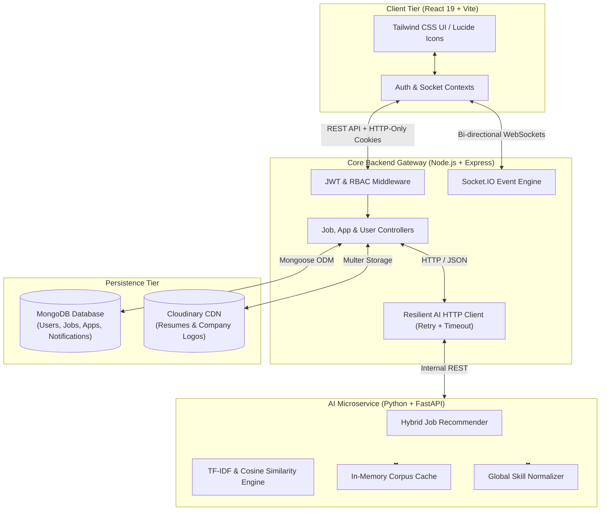

# 🎯 AI-Powered Smart Job Board

[](https://react.dev/)
[](https://vitejs.dev/)
[](https://tailwindcss.com/)
[](https://nodejs.org/)
[](https://expressjs.com/)
[](https://www.mongodb.com/)
[](https://www.python.org/)
[](https://fastapi.tiangolo.com/)
[](https://socket.io/)
[](https://cloudinary.com/)

An enterprise-grade, full-stack recruitment platform and applicant tracking system (ATS) engineered with a decoupled microservice architecture. It features a modern **React 19** frontend, a scalable **Node.js/Express** backend with **Socket.IO** real-time messaging, and an intelligent **Python (FastAPI)** machine learning microservice providing semantic search, explainable job recommendations, automated applicant ranking, and skill-gap analysis.

---

## 🌟 Key Highlights

- **🧠 Explainable AI Matching:** Recommends jobs and scores applicants using hybrid TF-IDF vectorization, cosine similarity, and skill overlap. Displays transparent match reasons (*"85% Match — You know React & Node.js; Missing: Docker"*).
- **⚡ Real-Time Notification Pipeline:** Event-driven architecture powered by Socket.IO for immediate alerts on new applications and status changes (Shortlisted, Reviewed, Rejected), backed by MongoDB persistence for offline durability.
- **📊 Interactive Analytics Dashboards:** Dedicated dashboards for students (skill-gap trends, match scores, application histories) and recruiters (hiring funnel metrics, top talent pool trends, applicant conversion rates).
- **🔍 Hybrid Semantic Search:** In-memory cached corpus vector search combining keyword relevance with natural language semantic discovery.
- **🛡️ Robust Security & File Handling:** Stateless JWT authentication stored in secure HTTP-only cookies, role-based access control (RBAC), and automated PDF resume/image uploads managed via Cloudinary.

---

## 🏗️ System Architecture



---

## 🚀 Detailed Features

### 🎓 For Candidates (Students)
- **Profile & Resume Management:** Profile builder with headline, bio, portfolio links, skill tags, and PDF resume upload via Cloudinary.
- **Smart Job Search & Filtering:** Filter by job type (Full-time, Part-time, Internship, Remote), salary range, location, and experience level.
- **Semantic Job Search:** Discover relevant jobs based on semantic intent, even without exact keyword matches.
- **Personalized Job Recommendations:** Jobs ranked based on resume skills, application history, and profile data with explainable match breakdowns.
- **Skill Gap Insights:** Visual breakdown of missing skills across applied jobs with personalized upskilling suggestions.
- **Real-Time Status Notifications:** Instant alerts and unread badges whenever recruiters review, shortlist, or update an application.
- **Saved & Applied Jobs Tracker:** Centralized management of application lifecycles.

### 🏢 For Recruiters & Employers
- **Company Profile Showcase:** Manage company logo, banner, overview, website, and company size.
- **Job Lifecycle Management:** Post, edit, update, toggle active status, and archive job postings.
- **Intelligent Applicant Ranking:** Automated candidate ranking based on ATS match scores and semantic relevance.
- **Recruitment Pipeline:** Smooth candidate review workflow (Pending → Reviewed → Shortlisted → Rejected → Hired) with automatic notification dispatch.
- **Talent Pool Analytics:** Real-time visibility into hiring funnel progression, applicant drop-off rates, and in-demand skill trends.

---

## 🛠️ Technology Stack

| Layer | Technologies |
| :--- | :--- |
| **Frontend** | React 19, Vite 6, Tailwind CSS v4, React Router DOM v7, React Hook Form, Zod, Sonner, Lucide React, Socket.IO Client |
| **Core Backend** | Node.js (ESM), Express 5, MongoDB, Mongoose 9, Socket.IO, JWT, bcryptjs, Helmet, Morgan, Cookie-Parser |
| **AI Microservice** | Python 3.12, FastAPI, Uvicorn, Scikit-learn, Spacy, PDFPlumber, HTTPX, Pydantic |
| **Media & Storage** | Cloudinary API, Multer Cloudinary Storage |
| **Architecture Patterns** | Microservices, Event-Driven WebSockets, Explainable AI, In-Memory Vector Caching |

---

## 📁 Repository Structure

```
smart-job-board/
├── backend/                  # Core Node.js/Express API & Socket.IO server
│   ├── src/
│   │   ├── config/           # MongoDB, Cloudinary, and Socket.IO configurations
│   │   ├── constants/        # Notification types and system constants
│   │   ├── controllers/      # Express route controllers (Auth, Jobs, Apps, AI)
│   │   ├── middleware/       # Auth guard, upload handler, error middleware
│   │   ├── models/           # Mongoose schemas (User, Job, Application, Notification)
│   │   ├── routes/           # RESTful API route definitions
│   │   ├── services/         # Application, Job, and Notification domain services
│   │   ├── utils/            # AI HTTP client, async handlers, token generators
│   │   └── validators/       # Zod request validation schemas
│   └── package.json
│
├── backend-ai/               # Python FastAPI Machine Learning microservice
│   ├── analytics/            # Skill-gap analysis and talent pool trend algorithms
│   ├── cache/                # In-memory TF-IDF corpus caching engine
│   ├── constants/            # Dynamic scoring weights (Skill, Title, Recency)
│   ├── ranking/              # Semantic search and candidate ranking algorithms
│   ├── recommenders/         # Personalized job recommendation engine
│   ├── services/             # PDF text extraction and NLP analyzers
│   ├── utils/                # Global skill normalization and dictionary
│   ├── main.py               # FastAPI application entrypoint
│   └── requirements.txt
│
└── frontend/                 # React 19 Single Page Application (SPA)
    ├── src/
    │   ├── components/       # UI components (Home, Jobs, Dashboard, Common)
    │   ├── context/          # Socket.IO client context
    │   ├── contexts/         # Authentication context and session state
    │   ├── data/             # Static navigation links, categories, filters
    │   ├── hooks/            # Custom hooks (useAuth, useDebounce, useSavedJobs)
    │   ├── layouts/          # MainLayout and DashboardLayout wrappers
    │   ├── pages/
    │   │   ├── public/       # Home, Jobs, JobDetails, Login, Register, About
    │   │   ├── recruiter/    # ManageJobs, PostJob, Applicants, Analytics, Settings
    │   │   └── student/      # StudentDashboard, AppliedJobs, SavedJobs, Analytics, Profile
    │   ├── routes/           # Protected routes and React Router configuration
    │   └── services/         # Axios API clients for backend endpoints
    └── package.json
```

---

## ⚡ Getting Started

### 📋 Prerequisites
- **Node.js** (v18.x or higher) & **npm**
- **Python** (v3.10 or higher) & **pip**
- **MongoDB** (Local instance or MongoDB Atlas cluster)
- **Cloudinary Account** (For image and PDF resume storage)

---

### 1️⃣ Clone the Repository
```bash
git clone https://github.com/ravikrishna27/Smart-Job-Board.git
cd Smart-Job-Board
```

---

### 2️⃣ Configure Environment Variables

#### Backend Configuration (`backend/.env`)
Create a `.env` file in the `backend/` directory:
```env
PORT=5000
NODE_ENV=development
MONGO_URI=mongodb://localhost:27017/smart-job-board
JWT_SECRET=your_super_secret_jwt_key_here
JWT_EXPIRES_IN=7d

# Cloudinary Credentials
CLOUDINARY_CLOUD_NAME=your_cloud_name
CLOUDINARY_API_KEY=your_api_key
CLOUDINARY_API_SECRET=your_api_secret

# URLs
CLIENT_URL=http://localhost:5173
SERVER_URL=http://localhost:5000
PYTHON_AI_URL=http://localhost:8000
```

#### Frontend Configuration (`frontend/.env`)
Create a `.env` file in the `frontend/` directory:
```env
VITE_API_URL=http://localhost:5000/api
```

---

### 3️⃣ Installation & Running Locally

#### Step A: Start the AI Microservice (Python FastAPI)
```bash
cd backend-ai
python -m venv venv

# Windows:
venv\Scripts\activate
# macOS/Linux:
source venv/bin/activate

pip install -r requirements.txt
uvicorn main:app --host 0.0.0.0 --port 8000 --reload
```
*The AI service will be available at `http://localhost:8000` (Docs at `http://localhost:8000/docs`).*

#### Step B: Start the Core Backend (Node.js & Express)
Open a new terminal window:
```bash
cd backend
npm install
npm run dev
```
*The API gateway and Socket.IO server will run on `http://localhost:5000`.*

#### Step C: Start the Frontend (React + Vite)
Open a third terminal window:
```bash
cd frontend
npm install
npm run dev
```
*The client application will run at `http://localhost:5173`.*

---

## 📡 API Overview

### Authentication & Users
- `POST /api/auth/register` — Register a new candidate or recruiter account
- `POST /api/auth/login` — Authenticate and receive HTTP-only JWT cookie
- `POST /api/auth/logout` — Invalidate session cookie
- `GET /api/users/profile` — Fetch authenticated user profile
- `PUT /api/users/profile` — Update candidate profile & upload resume

### Jobs
- `GET /api/jobs` — Retrieve paginated jobs with search and filters
- `GET /api/jobs/:id` — Get single job details
- `POST /api/jobs` — Post a new job *(Recruiter only)*
- `PUT /api/jobs/:id` — Update job posting *(Recruiter only)*
- `DELETE /api/jobs/:id` — Delete job posting *(Recruiter only)*

### Applications
- `POST /api/applications/:jobId` — Submit application with resume
- `GET /api/applications/my-applications` — Candidate's applied jobs
- `GET /api/applications/job/:jobId` — Retrieve all applicants for a job *(Recruiter only)*
- `PATCH /api/applications/:id/status` — Update applicant status & dispatch real-time event

### AI & Recommendations
- `POST /api/recommendations/search` — Semantic job search using corpus vectorization
- `GET /api/recommendations` — Fetch personalized recommendations *(Candidate only)*
- `GET /api/recommendations/student-gap` — Compute candidate skill-gap report *(Candidate only)*
- `GET /api/recommendations/recruiter-trends` — Compute talent pool analytics *(Recruiter only)*

### Notifications
- `GET /api/notifications` — Fetch user notifications
- `PATCH /api/notifications/:id/read` — Mark notification as read
- `PATCH /api/notifications/mark-all-read` — Mark all notifications as read

---

## 🔮 Future Enhancements

- [ ] **Direct Real-Time Messaging:** In-app chat between shortlisted candidates and hiring teams using existing WebSockets.
- [ ] **Transformer Embeddings:** Upgrade from TF-IDF vectorization to `sentence-transformers` for deep semantic contextual search.
- [ ] **Async Task Processing:** Introduce Redis and BullMQ / Celery for background PDF resume parsing and bulk email dispatches.
- [ ] **Automated Dockerization:** Docker Compose setup for one-command local orchestration across all three services.

---

## 👨‍💻 Author

**Donga Ravi Krishna**  
- **GitHub:** [@ravikrishna27](https://github.com/ravikrishna27)  
- **LinkedIn:** [Ravi Krishna Donga](https://www.linkedin.com/in/ravi-krishna-donga-8035512a4/)  
- **Email:** ravikrishnadrk2703@gmail.com

---

## 📄 License

This project is licensed under the [MIT License](LICENSE).
